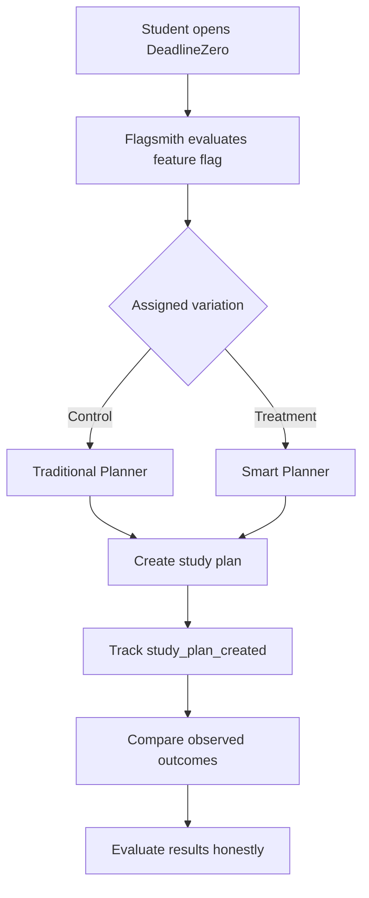
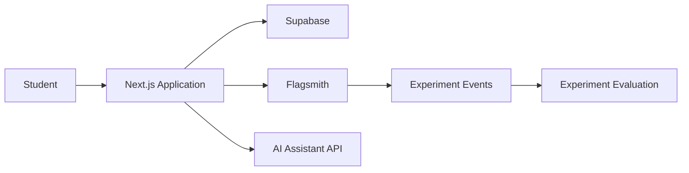

<div align="center">


### Your Academic Operating System

**Turn academic pressure into a plan you can actually follow.**

[Launch DeadlineZero](https://deadline-zero-eta.vercel.app/) · [GitHub Repository](https://github.com/dharmkoshiya74-collab/DeadlineZero)


**Team Vortex | Track 01 — Test Something Real**

</div>

---

## The problem

Students manage multiple subjects, assignments, examinations and deadlines. Traditional to-do lists tell them what is pending, but do not help them turn limited study time into a realistic plan.

## Our solution

DeadlineZero is an academic planning workspace that brings study planning, deadlines, sessions, progress tracking and AI assistance into one experience.

## Product features

| Feature | Purpose |
|---|---|
| Smart Planner | Intelligent study-planning experience |
| Traditional Planner | Simpler planning experience for comparison |
| Study Sessions | Organise and track study work |
| Calendar | View planned study activity |
| Progress Tracking | Monitor completed sessions |
| AI Assistant | Get academic planning assistance |
| Supabase | Authentication and application data |
| Flagsmith | Feature flags and A/B experimentation |

## The real-world experiment

We are testing a specific hypothesis:

> Does the Smart Planner experience help students create study plans more successfully than the Traditional Planner?

| Experiment component | Configuration |
|---|---|
| Experiment | DeadlineZero Study Planner A/B v2 |
| Feature flag | `study_planner_experience_v2` |
| Control | `traditional_planner` |
| Treatment | `smart_planner` |
| Primary event | `study_plan_created` |
| Secondary event | `study_session_completed` |
| Platform | Flagsmith |

### Experiment flow



We will report genuine participant data only. Small samples are useful for early feedback but cannot establish statistical significance.

## Technology stack

- Next.js and React
- TypeScript
- Tailwind CSS
- Supabase
- Flagsmith
- Groq API
- Vercel

## Run locally

### 1. Clone the repository

```bash
git clone https://github.com/dharmkoshiya74-collab/DeadlineZero.git
cd DeadlineZero
```

### 2. Install dependencies

```bash
npm install
```

### 3. Configure environment variables

Create `.env.local`:

```env
NEXT_PUBLIC_SUPABASE_URL=
NEXT_PUBLIC_SUPABASE_ANON_KEY=
NEXT_PUBLIC_FLAGSMITH_ENVIRONMENT_ID=
GROQ_API_KEY=
```

Use your own credentials. Never commit private keys.

### 4. Run the application

```bash
npm run dev
```

Visit http://localhost:3000.

### 5. Production build

```bash
npm run build
```

## Architecture



## Project structure

```text
DeadlineZero/
├── app/
│   ├── api/
│   ├── login/
│   ├── flagsmith-test/
│   ├── globals.css
│   ├── layout.tsx
│   └── page.tsx
├── assets/
│   └── deadlinezero-logo.svg
├── lib/
├── public/
├── .env.example
├── package.json
└── README.md
```

## Live demo

**[Open DeadlineZero](https://deadline-zero-eta.vercel.app/)**

**Demo video:** Add the final public video link here.

## What we want to learn

We want to understand whether a more intelligent planning experience helps students create plans and follow through with study sessions. Real usage, observed outcomes and participant feedback will guide the next improvements.

## Team

**Team Vortex**

Built for WeMakeDevs Toggle Wars 2026 — Track 01: Test Something Real.

---

<div align="center">

**DeadlineZero**

*Plan with clarity. Study with purpose. Finish with confidence.*

</div>
