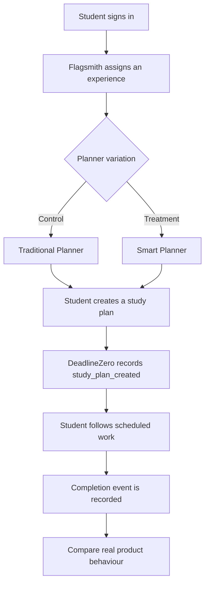

<div align="center">
  

  <h1>Turn academic pressure into a plan.</h1>
  <p><strong>Your academic operating system.</strong></p>
  <p>Plan study work around real deadlines, build consistent sessions, track progress, and get help from an AI academic assistant.</p>

  <p>
    <a href="https://deadline-zero-eta.vercel.app/"></a>
    <a href="https://github.com/dharmkoshiya74-collab/DeadlineZero"></a>
  </p>

  <p>
    
    
    
    
    
  </p>
</div>

---

## The idea

Students rarely struggle because they have nothing to do. They struggle because several subjects, assignments, and exams compete for the same limited hours.

A conventional checklist can record a deadline. It does not necessarily help a student turn that deadline into a realistic study routine.

**DeadlineZero is built to close that gap.** It brings academic planning, scheduled study sessions, progress visibility, and AI-powered guidance into one workspace.

## What you can do

| Capability | What it does |
|---|---|
| **Study planning** | Create a plan with a subject, deadline, and estimated study time. |
| **Smart Planner** | Uses available daily study time, difficulty, and priority to distribute work into study sessions. |
| **Traditional Planner** | Offers a simpler planning experience for comparison. |
| **Study calendar** | Review the sessions generated for your study plans. |
| **Progress tracking** | See study work and completed sessions in one place. |
| **AI academic assistant** | Ask for prioritisation, realistic schedules, recovery plans, progress-based suggestions, and help understanding topics. |
| **Student accounts** | Sign in to keep each student's planning data associated with their account. |

## The experiment: test the experience, not the assumption

DeadlineZero is being built for **WeMakeDevs Toggle Wars 2026 — Track 01: Test Something Real**.

We are testing one focused question:

> Does an intelligent study-planning experience improve successful study-plan creation compared with a traditional planning experience?

### Experiment design

| Element | Configuration |
|---|---|
| Feature flag | `study_planner_experience_v2` |
| Control variation | `traditional_planner` |
| Treatment variation | `smart_planner` |
| Primary event | `study_plan_created` |
| Additional event | `study_session_completed` |
| Feature-flag platform | Flagsmith |

Flagsmith identifies signed-in participants and supplies the assigned experiment variation. DeadlineZero records the relevant product events so the two experiences can be evaluated.

**We do not publish invented conversion rates or claim a winning variation before the data supports it.** Results should be interpreted alongside participant count, exposure, and the limitations of the sample.

## How it works



## Built with

| Layer | Technology | Role |
|---|---|---|
| Web application | Next.js 16, React 19 | Application framework and interface |
| Language | TypeScript | Typed application code |
| Styling | Tailwind CSS 4 | Responsive interface styling |
| Authentication & data | Supabase | Student authentication and application data |
| Feature flags & experiments | Flagsmith | Variation assignment and event tracking |
| AI assistant | Groq API | Streaming academic-assistant responses |
| Deployment | Vercel | Hosted application |

## Run it locally

### Requirements

- Node.js
- npm
- A Supabase project
- A Flagsmith environment
- A Groq API key

### 1. Clone the repository

```bash
git clone https://github.com/dharmkoshiya74-collab/DeadlineZero.git
cd DeadlineZero
```

### 2. Install dependencies

```bash
npm install
```

### 3. Configure environment variables

Create a `.env.local` file in the project root:

```env
NEXT_PUBLIC_SUPABASE_URL=
NEXT_PUBLIC_SUPABASE_ANON_KEY=
NEXT_PUBLIC_FLAGSMITH_ENVIRONMENT_ID=
GROQ_API_KEY=
```

Add the values from your own Supabase, Flagsmith, and Groq projects. Keep `.env.local` private; never commit credentials.

### 4. Start the development server

```bash
npm run dev
```

Open [http://localhost:3000](http://localhost:3000).

### 5. Check the production build

```bash
npm run build
```

## Repository map

```text
DeadlineZero/
├── app/
│   ├── api/assistant/       # AI assistant API
│   ├── login/               # Student sign-in and sign-up
│   ├── flagsmith-test/      # Experiment testing route
│   ├── globals.css          # Global styles
│   ├── layout.tsx           # Root layout and metadata
│   └── page.tsx             # Main application experience
├── lib/                     # Shared application utilities
├── public/                  # Static assets and brand mark
├── .env.example             # Environment variable template
├── package.json
└── README.md
```

## Try the project

<div align="center">
  <h3>See DeadlineZero in action</h3>
  <p>Open the deployed application and explore the student planning experience.</p>
  <a href="https://deadline-zero-eta.vercel.app/"><strong>Open the live application →</strong></a>
</div>

---

## Team

**Team Vortex**  
Built for **WeMakeDevs Toggle Wars 2026**.

---

<div align="center">
  <sub>Designed around a simple belief: students deserve more than another to-do list.</sub>
  <br />
  <sub>DeadlineZero · Plan with purpose. Finish with confidence.</sub>
</div>