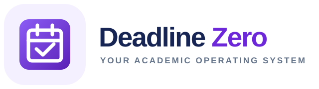
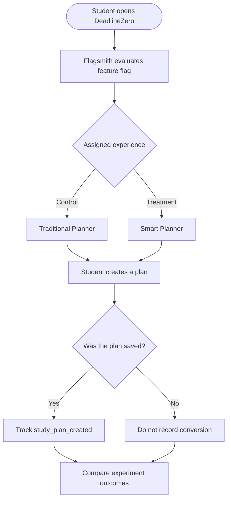
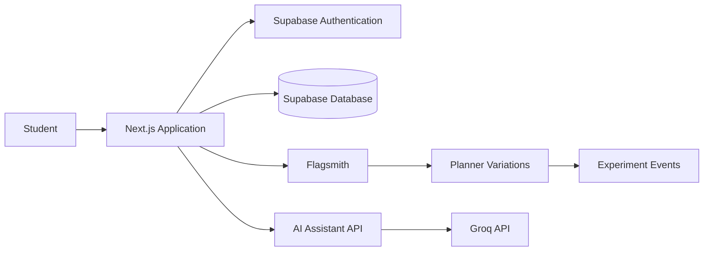

<div align="center">



### YOUR ACADEMIC LIFE, BROUGHT UNDER CONTROL.

**Turn academic pressure into a plan. Turn your plan into progress.**

<br/>

<a href="https://deadline-zero-eta.vercel.app/">
  
</a>
<a href="https://github.com/dharmkoshiya74-collab/DeadlineZero">
  
</a>

<br/><br/>


<br/>

**TEAM VORTEX** · WeMakeDevs Toggle Wars 2026 · Track 01 — Test Something Real

</div>

---

## 01 — The vision

Students manage multiple subjects, assignments, examinations and deadlines. A normal to-do list can store tasks, but it does not necessarily help students decide how to distribute their study time.

**DeadlineZero is an academic operating system** designed to bring planning, scheduling, study progress and AI assistance into one student workspace.

Our goal is simple:

> Help students understand what needs to be done, decide when to do it, and measure whether they are making progress.

## 02 — The product

| Feature | What it does |
|:--|:--|
| **Smart Planner** | Generates study sessions using study duration, available time and plan details. |
| **Traditional Planner** | Provides a simpler planning experience for comparison. |
| **Study Calendar** | Organizes scheduled study sessions. |
| **Progress Tracking** | Tracks completed study sessions and academic activity. |
| **AI Assistant** | Helps with academic planning and study-related questions. |
| **Authentication** | Provides student accounts and protected access. |
| **Experimentation** | Compares planner experiences using Flagsmith. |

## 03 — The experiment

<div align="center">

### DOES SMARTER PLANNING LEAD TO BETTER PLAN CREATION?

We are testing whether the Smart Planner increases successful study-plan creation compared with the Traditional Planner.

</div>

### Experiment configuration

| Setting | Value |
|:--|:--|
| Experiment | DeadlineZero Study Planner A/B v2 |
| Feature flag | `study_planner_experience_v2` |
| Control | `traditional_planner` |
| Treatment | `smart_planner` |
| Primary conversion | `study_plan_created` |
| Secondary event | `study_session_completed` |
| Experiment platform | Flagsmith |

### Experiment flow



### What we measure

- Successful study-plan creation — primary metric.
- Completed study sessions — supporting metric.
- Participant feedback — qualitative insight.

**We value honest experimentation.** We will not invent results or claim statistical significance from a small sample. Results should be interpreted in the context of the actual number of participants and conversions.

## 04 — System architecture



## 05 — Technology

<div align="center">

| Layer | Technology |
|:--|:--|
| Frontend | Next.js, React, TypeScript |
| Styling | Tailwind CSS |
| Authentication | Supabase Auth |
| Database | Supabase |
| Feature management | Flagsmith |
| AI assistance | Groq API |
| Deployment | Vercel |

</div>

## 06 — Run locally

### Prerequisites

- Node.js
- npm
- Supabase project
- Flagsmith environment
- Groq API key

### Step 1 — Clone the repository

```bash
git clone https://github.com/dharmkoshiya74-collab/DeadlineZero.git
cd DeadlineZero
```

### Step 2 — Install dependencies

```bash
npm install
```

### Step 3 — Configure environment variables

Copy `.env.example` to `.env.local` and configure your own credentials.

```env
NEXT_PUBLIC_SUPABASE_URL=
NEXT_PUBLIC_SUPABASE_ANON_KEY=
NEXT_PUBLIC_FLAGSMITH_ENVIRONMENT_ID=
GROQ_API_KEY=
```

Never commit `.env.local` or expose private API keys.

### Step 4 — Start the development server

```bash
npm run dev
```

Visit:

[http://localhost:3000](http://localhost:3000)

### Step 5 — Production build

```bash
npm run build
```

## 07 — Project structure

```text
DeadlineZero/
│
├── app/
│   ├── api/
│   │   └── assistant/
│   ├── login/
│   ├── flagsmith-test/
│   ├── globals.css
│   ├── layout.tsx
│   └── page.tsx
│
├── assets/
│   └── deadlinezero-logo.svg
│
├── lib/
├── public/
├── .env.example
├── package.json
└── README.md
```

## 08 — Live project

<div align="center">

### EXPERIENCE DEADLINEZERO

<a href="https://deadline-zero-eta.vercel.app/">
  
</a>

**Live application:** https://deadline-zero-eta.vercel.app/

**Source code:** https://github.com/dharmkoshiya74-collab/DeadlineZero

**Demo video:** Add the final public or unlisted YouTube/Loom link here.

</div>

## 09 — The team

<div align="center">

### TEAM VORTEX

Built for **WeMakeDevs Toggle Wars 2026**

*Build with intent. Test with evidence. Improve with data.*

<br/>


</div>

---

<div align="center">

**DEADLINEZERO** · Make every study session count.

</div>
